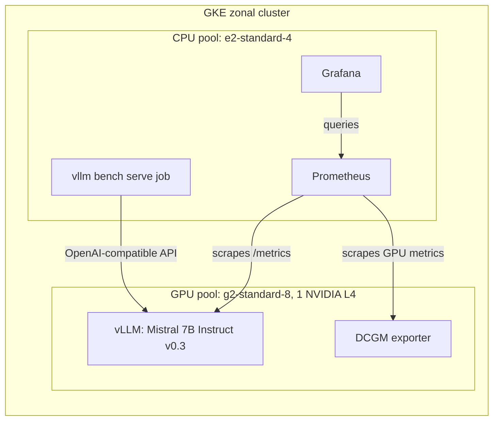

# Inferscope

> **Status: in progress.** No benchmark has been run yet. Everything marked PENDING has not been executed, and this repo holds no measured results.

## 1. Core question

How does a single-GPU vLLM deployment behave as concurrency grows, where does it saturate, and what does it cost per million output tokens?

## 2. Architecture

Planned design, not yet deployed:



## 3. Results

PENDING. No runs have been executed.

| Concurrency | TTFT p50/p95/p99 | TPOT p50/p95/p99 | E2E p50/p95/p99 | Output tokens/s | Error rate | Queue depth | GPU utilization |
|---|---|---|---|---|---|---|---|
| 1 | PENDING | PENDING | PENDING | PENDING | PENDING | PENDING | PENDING |
| 8 | PENDING | PENDING | PENDING | PENDING | PENDING | PENDING | PENDING |
| 32 | PENDING | PENDING | PENDING | PENDING | PENDING | PENDING | PENDING |
| 64 | PENDING | PENDING | PENDING | PENDING | PENDING | PENDING | PENDING |

Charts: PENDING.

## 4. Conclusions

PENDING. Conclusions will be written only from measured data.

## 5. Cost

PENDING. Two figures will be reported:

1. **GPU serving cost per 1M output tokens:** `node $/hr ÷ (output tokens/s × 3600) × 1,000,000`
2. **Estimated total lab cost**, including other relevant resources

Pricing sources, dates, assumptions and exclusions will be listed here. These are not production cost estimates.

## 6. Reproduce

Only `make preflight` works today. The other targets exit with a PENDING message and create nothing.

```bash
cp infra/terraform/terraform.tfvars.example infra/terraform/terraform.tfvars
# Edit terraform.tfvars with your own project and billing account.
make preflight
```

Requires `uv`, `gcloud`, `terraform`, `helm` and `kubectl`.

GCP budget alerts send notifications and do not cap spending. Run `make down` and `make teardown-check` when you finish.

## 7. Limitations and v2 ideas

PENDING. See [docs/decisions.md](docs/decisions.md) for the decisions made so far.
